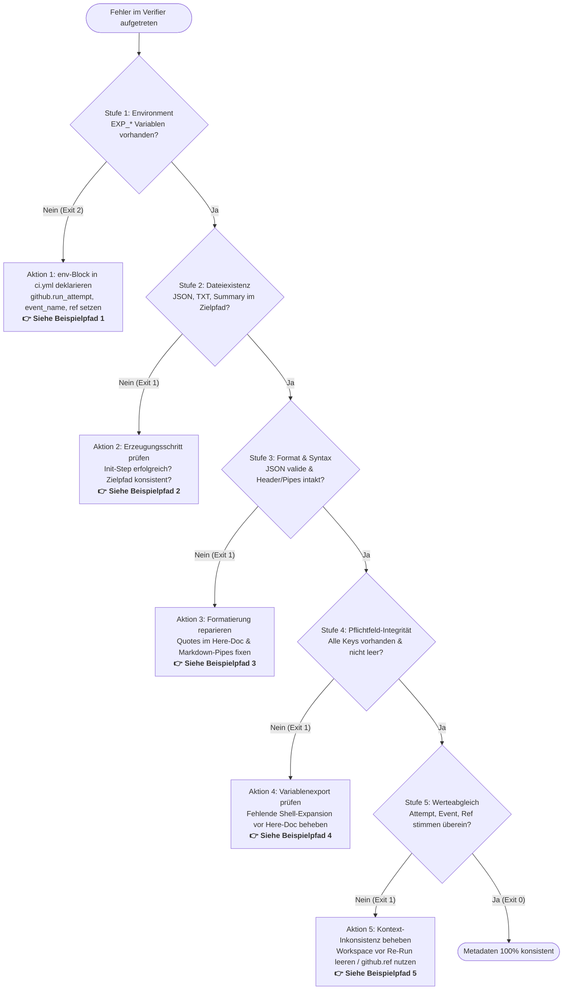
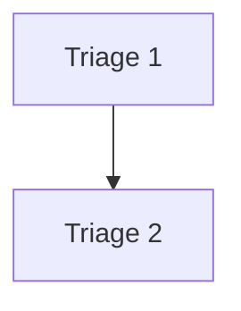
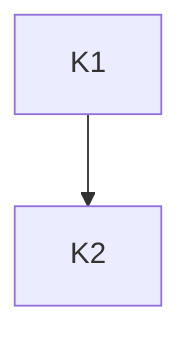

# HQRN CI - Dokumentation der Diagnose-Metadaten-Fehlerszenarien

Diese Dokumentation beschreibt die 15 automatisierten Fehlerszenarien der Negativ-Testsuite (`scripts/test_verify_diagnostic_metadata.py`) und der CI-Pipeline (`.github/workflows/ci.yml`), die sicherstellen, dass Inkonsistenzen zwischen GitHub Actions Umgebung, `metadata.json`, `diagnostic_metadata.txt` und `step_summary.md` zuverlässig und mit verständlichen Fehlermeldungen abgefangen werden.

---

## 1. Übersicht der Prüflogik (`verify_diagnostic_metadata.py`)

Das Prüfskript verifiziert die Übereinstimmung der drei zentralen Nachvollziehbarkeits-Parameter:
- **Workflow Run Attempt** (`EXP_RUN_ATTEMPT`): Laufende Nummer des Workflow-Versuchs (z. B. `1` oder `2` bei Re-Runs)
- **Trigger Event** (`EXP_TRIGGER_EVENT`): GitHub-Auslöser (`push`, `pull_request`, `workflow_dispatch`)
- **Git Ref** (`EXP_GIT_REF`): Vollständige Git-Referenz (z. B. `refs/heads/main`, `refs/pull/42/merge`)

### Exit-Codes
| Exit-Code | Bedeutung |
|:---:|---|
| **0** | Alle Dateien vorhanden, syntaktisch valide und 100% konsistent |
| **1** | Inhaltliche Inkonsistenz, fehlende Datei, fehlender Schlüssel oder Parse-Fehler |
| **2** | Fehlende oder leere Pflicht-Umgebungsvariablen im Ausführungskontext |

---

## 2. Matrix der 15 getesteten Fehlerszenarien

| ID | Test-Szenario | Injizierte Ursache | Erwarteter Exit-Code | Erwartete Fehlermeldung (Auszug) |
|:---:|---|---|:---:|---|
| **1** | **Konsistente Baseline** | Keine (alle Dateien synchron) | `0` | `[SUCCESS] All diagnostic metadata representations are 100% consistent!` |
| **2** | **JSON Run-Attempt Mismatch** | `metadata.json`: `workflow_run_attempt` abweichend | `1` | `metadata.json: workflow_run_attempt mismatch (got "2", expected "1")` |
| **3** | **JSON Trigger-Event Mismatch** | `metadata.json`: `trigger_event` manipuliert | `1` | `metadata.json: trigger_event mismatch (got "pull_request", expected "push")` |
| **4** | **JSON Git-Ref Mismatch** | `metadata.json`: `git_ref` abweichend | `1` | `metadata.json: git_ref mismatch (got "refs/pull/42/merge", expected "refs/heads/main")` |
| **5** | **JSON Fehlender Key** | Pflichtfeld in `metadata.json` entfernt | `1` | `metadata.json: key "trigger_event" is missing or empty` |
| **6** | **JSON Syntax-Fehler** | `metadata.json` beschädigt (ungültiges JSON) | `1` | `metadata.json parse error: ...` |
| **7** | **TXT Run-Attempt Mismatch** | `diagnostic_metadata.txt`: Wert manipuliert | `1` | `diagnostic_metadata.txt: Workflow Run Attempt mismatch (got "3", expected "1")` |
| **8** | **TXT Header Fehlt** | `Trigger Event:` Headerzeile gelöscht | `1` | `diagnostic_metadata.txt: "Trigger Event: <name>" header not found` |
| **9** | **TXT Git-Ref Mismatch** | `diagnostic_metadata.txt`: Ref manipuliert | `1` | `diagnostic_metadata.txt: Git Ref mismatch (got "refs/tags/v1.0.0", expected "refs/heads/main")` |
| **10** | **Summary Attempt Mismatch** | `step_summary.md`: Tabellenzeile abweichend | `1` | `step_summary.md: Run Attempt mismatch in summary (got "4", expected "1")` |
| **11** | **Summary Event Mismatch** | `step_summary.md`: Trigger-Event abweichend | `1` | `step_summary.md: Trigger-Event mismatch in summary (got "workflow_dispatch", expected "push")` |
| **12** | **Summary Git-Ref Mismatch** | `step_summary.md`: Git-Ref abweichend | `1` | `step_summary.md: Git-Ref mismatch in summary (got "refs/heads/experimental", expected "refs/heads/main")` |
| **13** | **Fehlende `metadata.json`** | Datei physisch nicht existent | `1` | `Missing file: .../metadata.json` |
| **14** | **Fehlende `step_summary.md`** | Datei physisch nicht existent | `1` | `Missing file: .../step_summary.md` |
| **15** | **Fehlende Env-Variablen** | `EXP_RUN_ATTEMPT` nicht deklariert | `2` | `[ERROR] Missing one or more expected environment variables (EXP_RUN_ATTEMPT, EXP_TRIGGER_EVENT, EXP_GIT_REF)` |

---

## 3. Geordnete Triage-Reihenfolge & Ursachen-Bestätigung

Zur schnellen Lokalisierung von CI- und Metadaten-Fehlern werden die Prüfschritte streng von der äußeren Ausführungsumgebung bis hin zu inhaltlichen Werten hierarchisch in 5 Stufen abgearbeitet.

### Triage-Ablaufdiagramm



> 💡 **Direktnavigation zu den Beispielpfaden** *(Universeller Fallback für GitHub & Viewer mit blockierten SVG-Klicks)*:  
> [👉 **Stufe 1: Environment**](#beispielpfad-1) • [👉 **Stufe 2: Dateiexistenz**](#beispielpfad-2) • [👉 **Stufe 3: Format & Syntax**](#beispielpfad-3) • [👉 **Stufe 4: Pflichtfeld-Integrität**](#beispielpfad-4) • [👉 **Stufe 5: Werteabgleich**](#beispielpfad-5)

### Stufenübersicht
1. **Stufe 1 (Laufzeitumgebung):** Sind alle GitHub Actions Kontextvariablen da? (Exit-Code 2)
2. **Stufe 2 (Dateiexistenz):** Wurden alle drei Metadaten-Artefakte physisch erzeugt? (Exit-Code 1)
3. **Stufe 3 (Format & Syntax):** Sind JSON und Regex-Muster wohlgeformt lesbar? (Exit-Code 1)
4. **Stufe 4 (Pflichtfeld-Integrität):** Sind alle erforderlichen Schlüssel vorhanden und nicht leer? (Exit-Code 1)
5. **Stufe 5 (Inhaltliche Konsistenz):** Stimmen die extrahierten Werte exakt mit dem Auslöser überein? (Exit-Code 1)

---

### Geordnete Prüfmatrix mit konkreter Bestätigungsmethodik

| Stufe & Priorität | Fehlermeldung (Muster) | Mögliche Ursache | Empfohlener Prüfschritt (Reihenfolge) | Woran sich die Ursache exakt bestätigen lässt |
|:---:|---|---|---|---|
| **Stufe 1**<br>_Environment_ | `[ERROR] Missing one or more expected environment variables (...)` | Dem Validator fehlen die GitHub-Runner-Kontextvariablen (`EXP_RUN_ATTEMPT`, `EXP_TRIGGER_EVENT` oder `EXP_GIT_REF`). | **1. Runner-Env deklarieren:**<br>`env:`-Block des Steps `Validate Diagnostic Metadata Consistency` in `ci.yml` auf Vollständigkeit prüfen. | **Exit-Code 2 im CI-Log** und Ausgabe von:<br>`env | grep -E "^EXP_(RUN_ATTEMPT|TRIGGER_EVENT|GIT_REF)="`<br>Eine oder mehrere Variablen fehlen oder sind leer (`EXP_RUN_ATTEMPT=""`). |
| **Stufe 2**<br>_Dateiexistenz_ | `Missing file: .../metadata.json`<br>`Missing file: .../diagnostic_metadata.txt`<br>`Missing file: .../step_summary.md` | Der Step `Initialize Diagnostic Metadata` wurde übersprungen, brach ab oder schrieb in ein anderes Verzeichnis. | **2. Erzeugungsschritt & Pfade prüfen:**<br>Prüfen, ob `Initialize Diagnostic Metadata` erfolgreich lief und `DIAGNOSTICS_DIR` (`sanitizer_diagnostics`) übereinstimmt. | **Exit-Code 1** und Dateisystem-Check:<br>`ls -la sanitizer_diagnostics/`<br>Bestätigt: Ordner existiert nicht oder eine der Zieldateien fehlt komplett. Im CI-Job steht der Init-Step auf rot oder "skipped". |
| **Stufe 3**<br>_Syntax & Format_ | `metadata.json parse error: ...` | Beschädigte JSON-Syntax (z. B. unescapte Anführungszeichen oder unzulässige Sonderzeichen im Here-Doc). | **3. JSON-Syntax validieren:**<br>Bash-Here-Doc auf saubere Quotierung (`"${VARIABLE}"`) prüfen. | Validierungsaufruf:<br>`python3 -m json.tool sanitizer_diagnostics/metadata.json`<br>Wirft expliziten `json.decoder.JSONDecodeError` mit Zeilen- und Spaltenangabe. |
| **Stufe 3**<br>_Syntax & Format_ | `diagnostic_metadata.txt: "<Header>" header not found` | Text-Header (`Workflow Run Attempt:`, `Trigger Event:` oder `Git Ref:`) fehlt oder wurde umbenannt. | **4. Text-Header-Muster prüfen:**<br>Prüfen, ob die Zeilen exakt `^(Header):\s*\S+` matchen. | Regex-Suche:<br>`grep -E "^(Workflow Run Attempt|Trigger Event|Git Ref):" sanitizer_diagnostics/diagnostic_metadata.txt`<br>Liefert weniger als 3 Treffer; Header fehlt oder enthält Tippfehler. |
| **Stufe 3**<br>_Syntax & Format_ | `step_summary.md: <Field> row not found in summary` | Markdown-Tabellensyntax beschädigt oder Zeile fehlt. | **5. Markdown-Tabelle prüfen:**<br>Tabelle auf intakte Pipes und Format-Tags prüfen. | Regex-Suche:<br>`grep -E "Run Attempt|Trigger-Event|Git-Ref" sanitizer_diagnostics/step_summary.md`<br>Tabellenzeile fehlt, Pipes sind asymmetrisch oder Backticks fehlen. |
| **Stufe 4**<br>_Vollständigkeit_ | `metadata.json: key "<key>" is missing or empty` | Ein Pflichtfeld fehlt im JSON-Objekt oder Shell-Variable expandierte zu `""`. | **6. JSON-Schlüsselintegrität prüfen:**<br>Sicherstellen, dass Variablen vor dem Here-Doc deklariert sind. | JSON-Key-Prüfung:<br>`jq -r ".workflow_run_attempt, .trigger_event, .git_ref" sanitizer_diagnostics/metadata.json`<br>Gibt `null` oder Leerzeile aus (z. B. Variable im CI-Step nicht exportiert). |
| **Stufe 5**<br>_Werteabgleich_ | `metadata.json: workflow_run_attempt mismatch (got "X", expected "Y")`<br>_analog TXT / Summary_ | Re-Run-Inkonsistenz: Datei enthält veralteten Versuchszähler (z. B. persistierter Workspace-Cache) oder statischen Wert. | **7. Attempt-Dynamik prüfen:**<br>Sicherstellen, dass `RUN_ATTEMPT: ${{ github.run_attempt }}` frisch evaluiert und der Ordner vorab geleert wird. | Direkter Wertevergleich:<br>`echo "File: $(jq -r .workflow_run_attempt sanitizer_diagnostics/metadata.json) vs Context: $EXP_RUN_ATTEMPT"`<br>Bestätigt: `got "1", expected "2"` (Datei aus Vorlauf nicht überschrieben). |
| **Stufe 5**<br>_Werteabgleich_ | `metadata.json: trigger_event mismatch (got "X", expected "Y")`<br>_analog TXT / Summary_ | Falsches Event im Template (z. B. hartkodiertes `push` bei `pull_request` oder `workflow_dispatch`). | **8. Event-Variable prüfen:**<br>`EVENT_NAME: ${{ github.event_name }}` im Generierungs-Step kontrollieren. | Direkter Wertevergleich:<br>`echo "File: $(jq -r .trigger_event sanitizer_diagnostics/metadata.json) vs Context: $EXP_TRIGGER_EVENT"`<br>Bestätigt: Divergenz zwischen Event-Auslöser und Template-Inhalt. |
| **Stufe 5**<br>_Werteabgleich_ | `metadata.json: git_ref mismatch (got "X", expected "Y")`<br>_analog TXT / Summary_ | Falsche Git-Ref-Auflösung (z. B. `${{ github.ref_name }}` statt `${{ github.ref }}` oder detached HEAD). | **9. Ref-Auflösung prüfen:**<br>Sicherstellen, dass einheitlich die vollständige `${{ github.ref }}` verwendet wird. | Direkter Wertevergleich:<br>`echo "File: $(jq -r .git_ref sanitizer_diagnostics/metadata.json) vs Context: $EXP_GIT_REF"`<br>Bestätigt: Dateiwert ist kurz (`main`), aber Kontext erwartet `refs/heads/main`. |


---

### Konkrete Beispielpfade je Triage-Stufe

<a id="beispielpfad-1"></a>
#### Beispielpfad 1: Stufe 1 – Ausführungsumgebung (Environment)
* **Typisches Fehlerbild:**
  ```text
  [ERROR] Missing one or more expected environment variables (EXP_RUN_ATTEMPT, EXP_TRIGGER_EVENT, EXP_GIT_REF)
  (Exit-Code 2)
  ```
* **Ursachenbestätigung:**
  Aufruf von `env | grep -E "^EXP_(RUN_ATTEMPT|TRIGGER_EVENT|GIT_REF)="` im Runner oder lokalen Terminal liefert eine leere Zeile oder unvollständige Variablenliste (z. B. `EXP_RUN_ATTEMPT=""`).
* **Passender nächster Schritt:**
  Im Step `Validate Diagnostic Metadata Consistency` der `.github/workflows/ci.yml` den `env:`-Block kontrollieren und die Zuweisung `EXP_RUN_ATTEMPT: ${{ github.run_attempt }}` explizit deklarieren.

<a id="beispielpfad-2"></a>
#### Beispielpfad 2: Stufe 2 – Dateiexistenz (Artefakt-Präsenz)
* **Typisches Fehlerbild:**
  ```text
  Missing file: sanitizer_diagnostics/metadata.json
  (Exit-Code 1)
  ```
* **Ursachenbestätigung:**
  `ls -la sanitizer_diagnostics/` zeigt, dass der Ordner leer ist oder fehlt. Im CI-Laufprotokoll steht der vorherige Step `Initialize Diagnostic Metadata` auf "skipped" oder schlug bereits mit einem Berechtigungs-/Pfadfehler fehl.
* **Passender nächster Schritt:**
  Sicherstellen, dass der Initialisierungs-Step bedingungslos (`if: always()`) ausgeführt wird und der Zielordner `${{ env.DIAGNOSTICS_DIR }}` (`sanitizer_diagnostics`) vor dem Erzeugen mit `mkdir -p` angelegt wird.

<a id="beispielpfad-3"></a>
#### Beispielpfad 3: Stufe 3 – Format & Syntax (Parsing & Header)
* **Typisches Fehlerbild:**
  ```text
  sanitizer_diagnostics/metadata.json parse error: Expecting property name enclosed in double quotes: line 4 column 5 (char 48)
  (Exit-Code 1)
  ```
* **Ursachenbestätigung:**
  `python3 -m json.tool sanitizer_diagnostics/metadata.json` bricht mit `json.decoder.JSONDecodeError` an Zeile 4 ab. Die Inspektion des Here-Docs zeigt ein vergessenes Anführungszeichen oder unescapte Backslashes in Pfaden.
* **Passender nächster Schritt:**
  Das Here-Doc `cat <<EOF > sanitizer_diagnostics/metadata.json` im Workflow-Step korrigieren: Alle String-Werte in Anführungszeichen setzen (`"${VARIABLE}"`) und überflüssige Kommas am Zeilenende entfernen.

<a id="beispielpfad-4"></a>
#### Beispielpfad 4: Stufe 4 – Pflichtfeld-Integrität (Vollständigkeit)
* **Typisches Fehlerbild:**
  ```text
  sanitizer_diagnostics/metadata.json: key "trigger_event" is missing or empty
  (Exit-Code 1)
  ```
* **Ursachenbestätigung:**
  `jq -r .trigger_event sanitizer_diagnostics/metadata.json` gibt einen leeren String aus. Die Shell-Variable `EVENT_NAME` war vor dem Schreiben des Templates nicht exportiert oder expandierte im Shell-Subprozess zu `""`.
* **Passender nächster Schritt:**
  Vor dem Schreiben des JSON-Templates sicherstellen, dass die Variable im Bash-Skript fest zugewiesen ist (`EVENT_NAME="${{ github.event_name }}"`) oder im Template ein Default-Fallback wie `"${EVENT_NAME:-unknown}"` hinterlegt ist.

<a id="beispielpfad-5"></a>
#### Beispielpfad 5: Stufe 5 – Inhaltlicher Werteabgleich (Kontext-Inkonsistenz)
* **Typisches Fehlerbild:**
  ```text
  sanitizer_diagnostics/metadata.json: workflow_run_attempt mismatch (got "1", expected "2")
  (Exit-Code 1)
  ```
* **Ursachenbestätigung:**
  Der Vergleichsbefehl `echo "File: $(jq -r .workflow_run_attempt sanitizer_diagnostics/metadata.json) vs Context: $EXP_RUN_ATTEMPT"` bestätigt den Mismatch (`got "1", expected "2"`). Die Metadatendatei stammt aus dem ersten Workflow-Versuch und wurde beim Re-Run aus einem Cache oder persistierten Verzeichnis übernommen, ohne neu geschrieben zu werden.
* **Passender nächster Schritt:**
  Im Initialisierungsschritt `Initialize Diagnostic Metadata` vor der Neugenerierung ein explizites `rm -rf sanitizer_diagnostics && mkdir -p sanitizer_diagnostics` ausführen, um alte Artefakte aus Vorläufen restlos zu verwerfen.

---

### Bekannte Einschränkungen der Diagramm-Interaktivität

| Plattform / Viewer | Mermaid `click ... href` Unterstützung | Verhalten & Ursache | Empfohlene Navigation |
|---|:---:|---|---|
| **GitHub.com**<br>*(Repo, PR, Issues, Wiki)* | ❌ Deaktiviert | GitHub erzwingt `DOMPurify` und `securityLevel: strict`. Interaktive `<a>`-Tags und Klick-Events in generierten SVGs werden aus XSS-Schutzgründen restlos gefiltert. | Die Schnellnavigationsleiste oberhalb der Stufenübersicht oder die Sprungmarken `[👉 Siehe Beispielpfad X]` im Fließtext nutzen. |
| **VS Code Markdown-Preview** | ⚠️ Eingeschränkt | Standard-Webview-CSP blockiert SVG-Scripting und Links. Nur mit lockeren Webview-Sicherheitseinstellungen interaktiv. | Standard-Markdown-Links in der Schnellnavigation verwenden. |
| **GitLab (Web)** | ⚠️ Instanzabhängig | Abhängig von der CSP-Konfiguration der GitLab-Instanz; relative SVG-Anker werden häufig ignoriert. | Native Markdown-Links der Schnellnavigation nutzen. |
| **Obsidian / JetBrains** | ✅ Vollständig | Interne Links (`href "#..."`) auf HTML-Anker (`<a id="...">`) im selben Dokument werden nativ unterstützt. | Klick direkt auf den Diagrammknoten oder Schnellnavigation. |
| **Docusaurus / MkDocs / Hugo** | ✅ Mit Config | Funktioniert, wenn das Mermaid-Plugin mit `securityLevel: loose` betrieben wird. | Klick auf Diagrammknoten voll funktionsfähig. |
| **PDF- & Druck-Export** | ❌ Nicht interaktiv | Statische Druck- und PDF-Engines (z. B. WeasyPrint, Chromium Headless) flachen SVGs in Vektor-/Rastergrafiken ohne Linkebenen ab. | Anker-Verweise im Text (`Beispielpfad X`) manuell ansteuern. |

---

## 4. Live-Injektion in GitHub Actions (`ci.yml`)

Im CI-Job `test-diagnostic-verifier-negative` werden neben der Python-Suite drei repräsentative Mismatch-Fälle inline mit Bash ausgeführt:
1. **Injected Run Attempt Mismatch**: Erwartet `1`, injiziert `99`. Prüft auf `workflow_run_attempt mismatch`.
2. **Injected Trigger Event Mismatch**: Erwartet `push`, injiziert `pull_request`. Prüft auf `trigger_event mismatch`.
3. **Injected Git Ref Mismatch**: Erwartet `refs/heads/main`, injiziert `refs/heads/fake_branch`. Prüft auf `git_ref mismatch`.

Jeder CI-Schritt evaluiert `set +e`, prüft `$EXIT_CODE -ne 0` und verifiziert per `grep`, dass die definierte Fehlermeldung exakt im Verifier-Log vorhanden ist. Würde der Verifier wider Erwarten mit `0` beenden, bricht der CI-Step mit einem expliziten Fehler ab.

---

## 5. Lokale Ausführung

```bash
# Über die Python-Testsuite direkt:
python3 scripts/test_verify_diagnostic_metadata.py

# Über das Makefile:
make test-metadata-negative

# Über CTest:
ctest -R test_metadata_verifier_negative --output-on-failure
```

---

## 6. Stabilität und Verifikation von Ankern und Querverweisen

Damit Sprungmarken aus Diagrammen (Mermaid `click ... href "#..."`) und Navigationsleisten (`[👉 ...](#...)`) auch nach redaktionellen Überarbeitungen, Umstrukturierungen oder Übersetzungen dauerhaft verlässlich bleiben, folgt die Dokumentation einer strikten Anker-Architektur und einem automatisierten Prüfverfahren.

### 6.1 Ursachen für instabile Überschriften-Anker
Standard-Markdown-Renderer (wie GitHub, GitLab, VS Code, Docusaurus) erzeugen interne Anker-IDs implizit aus dem Überschriftentext (sogenannte *Auto-Slugs*). Dieser Mechanismus birgt signifikante Risiken:
1. **Wortlaut-Kopplung:** Eine redaktionelle Änderung an der Überschrift (z. B. Umformulierung, Tippfehlerkorrektur, Ergänzung von Emojis) ändert den Slug lautlos (z. B. `#beispielpfad-1-stufe-1--environment` $\to$ `#beispielpfad-1-environment-runtime`). Bestehende Verweise brechen ohne Warnung.
2. **Plattform-Diskrepanzen:** Unterschiedliche Renderer behandeln Interpunktion (Gedankenstriche, Klammern, Doppelpunkte, Umlaute) uneinheitlich. Ein Slug, der lokal in VS Code auflöst, kann auf GitHub ins Leere führen.
3. **Hierarchie-Verschiebungen:** Wird eine Überschriftsebene geändert (`###` $\to$ `####`), brechen externe oder fragmentbasierte Deep-Links, falls Namensräume involviert sind.

### 6.2 Konvention für dauerhaft stabile Anker
Um die Anker von der Textgestaltung vollständig zu entkoppeln, gelten folgende verbindliche Konventionen:

* **Explizite HTML-Anker-Tags:** Unmittelbar vor der jeweiligen Überschrift wird ein eigenständiges `<a id="anker-name"></a>` (oder `<span id="anker-name"></span>`) platziert:
  ```html
  <a id="beispielpfad-1"></a>
  #### Beispielpfad 1: Stufe 1 – Ausführungsumgebung (Environment)
  ```
* **Kompakte, semantisch neutrale IDs:** Anker-IDs verwenden ausschließlich Kleinbuchstaben im Kebab-Case (`[a-z0-9_-]+`), keine Emojis, keine Umlaute und keine dynamischen Titelbestandteile (z. B. `beispielpfad-1` bis `beispielpfad-5`).
* **Unabhängigkeit vom Überschriften-Wording:** Der Text der Überschrift darf beliebig umformuliert, erweitert oder in andere Sprachen übersetzt werden, ohne dass Diagramme (`click A1 href "#beispielpfad-1"`) oder Markdown-Links angepasst werden müssen.
* **Alias- und Migrationsstrategie:** Falls eine Anker-ID aus Architekturgründen umbenannt werden muss, bleibt der bisherige Anker als Alias direkt daneben erhalten:
  ```html
  <a id="beispielpfad-1"></a><a id="triage-env-runtime"></a>
  #### Beispielpfad 1: ...
  ```
  Dadurch bleiben auch historische Deep-Links und Lesezeichen funktionsfähig.

---

### 6.3 Automatisierte Prüfung (`verify_markdown_anchors.py`)

Zur Qualitätssicherung existiert das Prüfskript `scripts/verify_markdown_anchors.py`. Es prüft Dokumentationsdateien auf Vollständigkeit und verwaiste Verweise:

1. **Ziel-Extraktion:**
   - Scannt alle expliziten HTML-Anker (`<a id="...">`, `<span id="...">`, `id="..."`).
   - Scannt alle Markdown-Überschriften und berechnet deren standardisierte GitHub-kompatible Slugs.
   - Registriert Zeilennummern und warnt bei duplizierten IDs.
2. **Referenz-Extraktion:**
   - Extrahiert alle internen Markdown-Links (`[Text](#ziel)`).
   - Extrahiert alle Mermaid-Klickverweise (`click Knoten href "#ziel"`).
3. **Integritätsprüfung:**
   - Verifiziert, dass jedes Referenzziel in der Menge der definierten Ziele existiert (*Zero Broken References*).
   - Prüft über den Parameter `--required <id> ...`, dass alle essenziellen Triage-Pfade (`beispielpfad-1` bis `beispielpfad-5`) physisch vorhanden sind.
4. **Fehlerausgabe & Exit-Codes:**
   - `0`: Alle internen Verweise und Pflichtanker sind valide.
   - `1`: Mindestens ein gebrochener interner Link, fehlender Pflichtanker oder Syntaxfehler.
   - `2`: Datei nicht gefunden oder Argumentfehler.

Beispiel für eine Fehlerausgabe bei einem Tippfehler:
```text
=== Verifying anchors in: DIAGNOSTIC_METADATA_TESTING.md ===
Found 26 defined target anchors/slugs.
Found 10 internal anchor references.

[FAIL] Found 1 broken anchor references:
  Line 65 [Mermaid click]: node A1 -> #beispielpfad-typo (Target does not exist!)
```

---

### 6.4 Lokale Ausführung & CI-Integration

#### Lokale Überprüfung

```bash
# Direkt über Python:
python3 scripts/verify_markdown_anchors.py DIAGNOSTIC_METADATA_TESTING.md --required beispielpfad-1 beispielpfad-2 beispielpfad-3 beispielpfad-4 beispielpfad-5

# Ausführen der dazugehörigen Unittests:
python3 scripts/test_verify_markdown_anchors.py

# Über das Makefile:
make test-doc-anchors

# Über CTest:
ctest -R test_doc_anchors --output-on-failure
```

#### GitHub Actions CI-Workflow
Im CI-Job `test-diagnostic-verifier-negative` der `.github/workflows/ci.yml` wird dieser Schritt automatisch bei jedem Pull-Request und Push auf den `main`-Branch ausgeführt:

```yaml
      - name: Verify Documentation Anchor and Link Integrity
        run: |
          echo "=== Verifying Markdown and Mermaid Anchor Integrity ==="
          python3 scripts/verify_markdown_anchors.py DIAGNOSTIC_METADATA_TESTING.md --required beispielpfad-1 beispielpfad-2 beispielpfad-3 beispielpfad-4 beispielpfad-5
```

---

### 6.5 Regressionstests für Spezialszenarien

In der Testsuite `scripts/test_verify_markdown_anchors.py` sind 10 dedizierte Unittests und Regressionstests hinterlegt, die spezifische Rand- und Fehlerfälle abdecken:

#### A. Relative Links (Markdown & Mermaid)
Querverweise dürfen nicht nur als reine Fragment-Links (`#anker`), sondern auch mit relativen Pfaden notiert werden:
* **Intra-File (gleiche Datei):** Verweise wie `[Link](./DIAGNOSTIC_METADATA_TESTING.md#beispielpfad-1)` oder Mermaid `click A href "./DIAGNOSTIC_METADATA_TESTING.md#beispielpfad-1"` werden auf die aktuelle Datei aufgelöst und gegen die lokalen Anker geprüft.
* **Inter-File (dokumentübergreifend):** Verweise wie `[Anleitung](./guide.md#schritt-2)` oder Mermaid `click B href "./guide.md#schritt-2"` prüfen in zwei Stufen:
  1. Physische Existenz der Zieldatei (`./guide.md`). Fehlt die Datei, schlägt die Prüfung mit `Target file does not exist` fehl.
  2. Vorhandensein des Zielankers `#schritt-2` in der Zieldatei. Fehlt der Anker, schlägt die Prüfung mit `Anchor #schritt-2 not found in guide.md` fehl.

```markdown
<!-- Beispiel: Relative Markdown- und Mermaid-Verweise -->
[Relativer Link](./DIAGNOSTIC_METADATA_TESTING.md#beispielpfad-1)


```

#### B. URL-kodierte Anker (Percent-Encoding)
Wenn Links durch Generatoren, CMS-Pipelines oder Browser URL-kodiert werden, enthalten sie Prozent-Sequenzen (z. B. `%2D` für Bindestriche oder UTF-8-Hex-Codes wie `%C3%BC` für `ü`):
* Der Verifier normalisiert referenzierte Anker automatisch via `urllib.parse.unquote()`.
* Verweise wie `[Pfad 1](#beispielpfad%2D1)` oder Mermaid `click N href "#beispielpfad%2D1"` lösen zuverlässig auf `<a id="beispielpfad-1"></a>` auf.
* Ebenso lösen kodierte Überschriften wie `[Stufe 1](#stufe%2D1%2Dausf%C3%BChrung)` auf `#### Stufe 1: Ausführung` auf.
* Ungültig kodierte Ziele (z. B. `#nicht%2Dvorhanden`) werden eindeutig mit Zeilennummer und Fehlergrund gemeldet.

#### C. Mehrfach verwendete IDs (Duplikate & Kollisionen)
* **Explizite HTML-IDs:** Gemäß W3C-Standard müssen `id`-Attribute im DOM eindeutig sein. Mehrfache Definitionen wie `<a id="beispielpfad-1"></a>` führen dazu, dass Browser und SVG-Link-Handler nur das erste Element anspringen. Der Verifier erkennt Duplikate und listet alle Zeilennummern auf:
  ```text
  [WARNING] Duplicate explicit anchor definition 'beispielpfad-1' on lines: [103, 219]
  ```
  Mit dem Flag `--strict-duplicates` bricht der Verifier mit Exit-Code 1 ab, um doppelte Anker in CI-Pipelines strikt zu verhindern.
* **Markdown-Überschriften (GitHub-Disambiguierung):** Haben zwei Überschriften denselben Text (z. B. zweimal `## Konfiguration`), hängt GitHub automatisch Suffixe an (`#konfiguration` und `#konfiguration-1`). Der Verifier repliziert diesen Mechanismus exakt und erlaubt zielgerichtete Verweise auf beide Instanzen.

```markdown
<!-- Beispiel: Disambiguierung mehrfacher Überschriften -->
## Konfiguration
Inhalt A...

## Konfiguration
Inhalt B...

[Zur ersten Konfiguration](#konfiguration)
[Zur zweiten Konfiguration](#konfiguration-1)


```

#### D. Fehlerbehandlung: Ungültige Kodierungen, fehlende Dateien und leere Anker
Der Verifier unterscheidet fehlerhafte Verweise mit präzisen Diagnosemeldungen:
* **Ungültige Prozentkodierung (RFC 3986 & UTF-8):** Enthält ein Anker fehlerhafte Prozentzeichen (`%` ohne zwei hexadezimale Ziffern, z. B. `%ZZ`, `%2`, trailing `%`) oder eine ungültige UTF-8 Bytefolge (`%FF%FE`), bricht die Prüfung mit klarer Fehlermeldung ab:
  ```text
  Invalid percent-encoding in anchor #kaputt%ZZ: malformed percent-encoding syntax (expected %HH hex digits, got "%ZZ")
  Invalid percent-encoding in anchor #bad%FF%FE: invalid UTF-8 byte sequence in percent-encoding (...)
  ```
* **Fehlende Zieldateien & Pfade:** Zeigt ein relativer Verweis auf eine nicht existierende Datei oder auf ein Verzeichnis statt einer Markdown-Datei:
  ```text
  Target file does not exist: ./missing_file.md
  Target path is a directory, not a file: ./subfolder
  ```
* **Leere Anker:** Zeigt ein Verweis auf ein isoliertes `#`, eine Zieldatei ohne Anker-ID (`doc.md#`) oder ein leeres Link-Ziel `()`:
  ```text
  Empty anchor reference: '#' (no anchor ID specified)
  Empty anchor reference: './doc.md#' (no anchor ID specified)
  ```

#### E. Standardfehlerausgabe (stderr), Standardausgabe (stdout) und Exit-Codes
Zur sauberen Einbindung in CI-Pipelines, Shell-Skripte und Entwicklungswerkzeuge trennt der Verifier Diagnose- und Statusströme strikt:
* **Exit-Codes:**
  * `0`: Alle internen Anker, relativen Links und Pflicht-IDs lösen fehlerfrei auf.
  * `1`: Mindestens ein interner Verweis ist gebrochen, eine Pflicht-ID fehlt, oder doppelte IDs wurden mit `--strict-duplicates` gefunden.
  * `2`: Die übergebene Markdown-Eingabedatei existiert nicht oder ein CLI-Argument ist fehlerhaft.
* **Standardfehlerausgabe (`stderr`):**
  * Alle Fehlerdiagnosen werden ausnahmslos auf `stderr` ausgegeben.
  * Bei Validierungsfehlern (Exit 1) listet `stderr` die Zusammenfassung `[FAIL] Found N broken anchor references:` sowie zeilengenaue Einträge:
    ```text
    Line 4 [Markdown link]: [Bad Hex] -> #kaputt%ZZ (Invalid percent-encoding in anchor #kaputt%ZZ: malformed percent-encoding syntax ...)
    Line 12 [Markdown link]: [Missing] -> ./absent.md#sec (Target file does not exist: ./absent.md)
    Line 20 [Markdown link]: [Empty] -> # (Empty anchor reference: '#' (no anchor ID specified))
    ```
  * Bei Dateifehlern (Exit 2) erscheint `[ERROR] Target file not found: <Pfad>` auf `stderr`.
* **Standardausgabe (`stdout`):**
  * Auf `stdout` werden ausschließlich der Scan-Header (`=== Verifying anchors in: ... ===`) sowie die Anker-/Linkzähler ausgegeben. Auf stdout treten im Fehlerfall keinerlei `[FAIL]`- oder Fehlermeldungen auf.

#### F. Unicode-Anker und Grenzfälle bei Mehrbyte-Prozentsequenzen
Der Verifier unterstützt moderne Dokumentationen mit internationalen Zeichensätzen, mathematischer Notation und Emojis:
* **Literale Unicode-Headings und HTML-IDs:**
  * Griechische mathematische Symbole (`λ`, `θ`) und deutsche Umlaute (`ä`, `ö`, `ü`, `ß`) bleiben in GitHub-Slugs erhalten (z. B. `#griechische-resonanz-λ-moden-θ-phasen`).
  * Asiatische Schriftsysteme wie CJK (`日本語`) werden unverändert im Slug bewahrt (`#cjk-abschnitt-日本語とdspアルゴリズム`).
  * Explizite HTML-Anker unterstützen auch Symbole und 4-Byte-Emojis (z. B. `<a id="audio-dsp-🚀-fasttrack"></a>`).
* **Valide Mehrbyte-Prozentkodierungen (UTF-8):**
  * 2-Byte-Sequenzen: `%CE%BB` (λ), `%CE%B8` (θ), `%C3%BC` (ü), `%C3%9F` (ß)
  * 3-Byte-Sequenzen: `%E6%97%A5%E6%9C%AC%E8%AA%9E` (日本語), `%E2%82%AC` (€)
  * 4-Byte-Sequenzen: `%F0%9F%9A%80` (🚀), `%F0%9F%8E%A7` (🎧)
* **Grenzfälle und fehlerhafte Mehrbyte-Sequenzen:**
  * Abgeschnittene Sequenzen (z. B. `%C3`, `%E6%97`, `%F0%9F%9A`)
  * Ungültige Continuation-Bytes (z. B. `%C3%28`, `%E6%97%28`)
  * Overlong-Encodings (z. B. `%C0%AF`, `%C1%BF`) und Codepoints über U+10FFFF (`%F5%80%80%80`)
  * Werden zuverlässig als `invalid UTF-8 byte sequence in percent-encoding` auf `stderr` abgewiesen (Exit 1).

#### G. Property-Based Testing (RFC 3986 & Invarianten)
Um die Robustheit gegenüber beliebigen Unicode-Eingaben mathematisch abzusichern, formuliert das Testmodul `fuzz_percent_encoding.py` und die Testsuite vier fundamentale Invarianten:
1. **RFC 3986 Roundtrip Preservation:**
   Für jeden beliebigen, gültigen Unicode-String $U$ (erzeugt über ASCII, Latin-1, Griechisch, Kyrillisch, CJK, Emojis und Astral-Ebenen bis U+10FFFF) gilt nach der RFC-3986-Prozentkodierung:
   $$\text{check\_percent\_encoding}(\text{quote}(U)) = (\text{True}, U, \text{None})$$
   Die Dekodierung stellt den exakten Unicode-String ohne Informationsverlust wieder her.
2. **Hex Case-Insensitivity Invariante:**
   Die hexadezimalen Ziffern in `%HH`-Tokens sind case-insensitiv (`%ce%bb` $\equiv$ `%CE%BB` $\equiv$ `%cE%Bb`). Beliebige Groß-/Kleinschreibungsvariationen in den Prozenttokens dekodieren bitexakt zum selben Zielanker.
3. **Crash-Freedom / Total Function Invariante:**
   Die Funktion `check_percent_encoding(s)` wirft unter keinen Umständen ungefangene Ausnahmen (wie `UnicodeDecodeError`, `UnicodeEncodeError`, `IndexError` oder `ValueError`). Selbst bei isolierten UTF-16-Surrogates (`\uD800`..`\uDFFF`), Nullbytes (`\x00`), rekursiven Prozentfolgen (`%%%%`) oder ungültigen Typen liefert die Funktion stets ein definiertes 3-Tupel `(is_valid, decoded, error_msg)`.
4. **Ground-Truth UTF-8 Äquivalenz:**
   Für beliebige pseudozufällige Bytefolgen stimmt die Gültigkeitsentscheidung von `check_percent_encoding` zu 100 % mit Pythons nativer UTF-8-Referenzdekodierung (`bytes.decode('utf-8')`) überein.

#### H. Fuzzing & Mutationstests (Syntax, UTF-8-Grenzen, Pipeline)
Zur Erkennung unerwarteter Randfälle stehen drei Fuzzing-Engines bereit:
* **Syntax-Fuzzing:** Injiziert zufällige syntaktische Defekte wie abgeschnittene `%`-Tokens am Stringende, einzelne Hexziffern vor Nicht-Hex-Zeichen, ungültige Hex-Paare (`%ZZ`, `%??`), Steuerzeichen und Doppel-Prozente (`%%`). Alle Mutationen werden zuverlässig mit `malformed percent-encoding syntax` auf `stderr` abgewiesen.
* **UTF-8-Boundary-Fuzzing:** Erzeugt gezielt Sequenzen, die die RFC-3629-Grenzen verletzen:
  * Abgeschnittene 2-, 3- und 4-Byte-Sequenzen ohne vollständige Folgebits
  * Ungültige Continuation-Bytes (Werte $< 0x80$ oder $\ge 0xC0$)
  * Overlong-Encodings (2-Byte für ASCII, 3-Byte für 2-Byte, 4-Byte für 3-Byte)
  * UTF-16-Surrogates im UTF-8-Bytestrom (U+D800 bis U+DFFF via `%ED%A0%80`..`%ED%BF%BF`)
  * Out-of-Range-Werte $> \text{U+10FFFF}$ (`%F4%90%80%80`..`%F7%BF%BF%BF`) sowie veraltete 5-/6-Byte-Header
  * Isolierte Continuation-Bytes (`%80`..`%BF`) ohne führenden Header
* **End-to-End Pipeline Fuzzing:** Generiert 50 vollständig randomisierte Markdown-Dokumente mit verschachtelten Headings, HTML-Ankern, Markdown-Links und Mermaid-Click-Direktiven. Überprüft, dass der gesamte Verifizierungs- und Parsing-Prozess deterministisch abschließt und niemals mit einem unerwarteten Laufzeitfehler abbricht.

```bash
# Standalone Fuzzing-Lauf mit individueller Iterationszahl und Pseudorandom-Seed:
python3 scripts/fuzz_percent_encoding.py --iterations 2000 --seed 1337 --verbose

# Ausführung im Rahmen des Makefiles:
make -C /mnt/documents test-fuzz
```

#### I. Unicode-Parität zwischen Markdown-Links und Mermaid-Klickzielen
Um eine konsistente Dokumentationsnavigation sicherzustellen, müssen reguläre Markdown-Links `[Text](#anker)` und interaktive Mermaid-Klickziele `click Node href "#anker"` eine bitexakte funktionale Äquivalenz aufweisen. Der Verifier garantiert diese Parität über alle Dimensionen hinweg:
* **Identische Positivauflösung:**
  * Griechische mathematische Notationen (`#λ-resonator-48k`, `#resonanz-θ-winkel-dämpfung`)
  * Deutsche Sonderzeichen und Umlaute (`#übertragungsfunktion-äöüß`, `#höhere-nichtlinearitäten`)
  * Asiatische Schriftzeichen (`#日本語-音響フィルタ`, `#cjk-サブシステムとdsp処理`)
  * Emojis und Astral-Ebenen (`#true-peak-🚀-limiter`, `#audiophile-🎧-monitoring`)
  * Sowohl literale Unicode-Notationen als auch RFC-3986-Prozentkodierungen (`%CE%BB`, `%C3%BC`, `%E6%97%A5`, `%F0%9F%9A%80`) lösen in Markdown-Links und Mermaid-Direktiven auf das identische Ziel auf.
* **Identische Fehler- und Diagnosemeldungen:**
  * Fehlt ein Unicode-Zielanker, listen Markdown- und Mermaid-Verweise denselben Zielanker und Fehlergrund auf `stderr` (Exit 1).
  * Syntaktisch oder byteweise ungültige Mehrbyte-Folgen (`%CE`, `%C3%28`, `%C0%AF`) werden bei beiden Linkarten mit der identischen `Invalid percent-encoding in anchor`-Meldung abgewiesen.
* **Cross-File-Parität:**
  * Auch dateiübergreifende relative Pfade mit Unicode-Namen (`./ziel_dokument_λ.md#moden-θ-48khz`) werden in beiden Syntaxen identisch aufgelöst.
* **Differentielles Fuzzing:**
  * Das Testmodul `fuzz_percent_encoding.py --mode parity` verifiziert über tausende randomisierte Unicode-Strings, dass ein Markdown-Link genau dann auflöst, wenn auch die äquivalente Mermaid-Direktive auflöst ($MD_{\text{valid}} \iff \text{Mermaid}_{\text{valid}}$).

#### Matrix der 28 Tests (`test_verify_markdown_anchors.py`)

| Test-Methode | Gegenstand | Prüfmechanismus & Erwartung |
|---|---|---|
| `test_basic_explicit_anchors_and_mermaid` | Standard HTML-Anker & Mermaid | Validiert Auflösung von `<a id="...">` und `click ... href "#..."` (Exit 0, leerer stderr). |
| `test_broken_markdown_and_mermaid_links` | Defekte interne Verweise | Erkennt gebrochene Markdown- und Mermaid-Links mit Zeilenangabe auf stderr (Exit 1). |
| `test_relative_links_same_file` | Relative Intra-File-Links | Löst `./file.md#anker` und `file.md#anker` lokal auf (Exit 0, leerer stderr). |
| `test_relative_links_cross_file` | Dokumentübergreifende Links | Prüft Existenz der Zieldatei und Lösbarkeit des Ankers extern (Exit 0, leerer stderr). |
| `test_relative_links_broken_target_file_or_anchor` | Defekte relative Pfade/Anker | Meldet fehlende Zieldatei (`missing_file.md`) und fehlende Anker getrennt auf stderr (Exit 1). |
| `test_url_encoded_anchors_resolution` | URL- und Prozent-Kodierung | Validiert `%2D` und UTF-8-Umlaut-Encodings (`%C3%BC`) in Markdown & Mermaid (Exit 0). |
| `test_url_encoded_broken_anchor_rejection` | Defekte URL-kodierte Ziele | Weist nicht existierende kodierte Anker mit lesbarer Fehlermeldung auf stderr ab (Exit 1). |
| `test_duplicate_explicit_id_warning` | Mehrfach vergebene HTML-IDs | Warnt standardmäßig auf stdout; schlägt mit `--strict-duplicates` auf stderr fehl (Exit 1). |
| `test_duplicate_markdown_headings_disambiguation` | Duplizierte Headings | Validiert GitHub-Suffixing (`-1`, `-2`) für Markdown- und Mermaid-Klicks (Exit 0). |
| `test_exit_code_and_stderr_invalid_percent_encoding` | Exit 1 & stderr: Prozentfehler | Prüft Exit-Code 1, `[FAIL]`, Zeilennummern und Parser-Meldung auf stderr; sauberer stdout. |
| `test_exit_code_and_stderr_missing_target_files_and_directories` | Exit 1 & stderr: Fehlende Dateien | Prüft Exit-Code 1, `Target file does not exist` und Verzeichnisabweisung auf stderr. |
| `test_exit_code_and_stderr_empty_anchors` | Exit 1 & stderr: Leere Anker | Prüft Exit-Code 1, `Empty anchor reference` für `#`, `file.md#` und `()` auf stderr. |
| `test_exit_code_and_stderr_cli_and_missing_input_file` | Exit 2 & stderr: Eingabe-/CLI-Fehler | Prüft Exit-Code 2 bei fehlender Datei (`[ERROR] Target file not found`) und falschen CLI-Flags. |
| `test_unicode_anchors_and_multibyte_percent_encoding_success` | Unicode & Mehrbyte-Prozent (2/3/4-Byte) | Validiert λ/θ, ä/ö/ü/ß, 日本語, €, 🚀 als Literal & Prozentfolge (%CE%BB, %F0%9F%9A%80) (Exit 0). |
| `test_multibyte_percent_encoding_edge_cases_and_rejections` | Mehrbyte-Grenzfälle & Ablehnung | Weist abgeschnittene Sequenzen, Bad Continuation, Overlong und Out-of-Range auf stderr ab (Exit 1). |
| `test_production_diagnostic_metadata_doc` | Reales Produktionsdokument | Prüft `DIAGNOSTIC_METADATA_TESTING.md` mit `--required` und `--strict-duplicates` (Exit 0). |
| `test_property_rfc3986_unicode_roundtrip` | Invariante 1: RFC 3986 Roundtrip | Prüft 1.000 beliebige Unicode-Strings aller Ebenen auf bitexakte Wiederherstellung (Exit 0). |
| `test_property_hex_case_insensitivity` | Invariante 2: Hex-Case-Invarianz | Prüft 1.000 Prozentsequenzen mit wechselnder Groß-/Kleinschreibung der Hex-Ziffern (Exit 0). |
| `test_property_crash_freedom_total_function` | Invariante 3: Crash-Freedom | Prüft 2.000 Permutationen (Surrogates, Nullbytes, arbitrary types) auf Ausnahme-Freiheit (Exit 0). |
| `test_property_groundtruth_utf8_equivalence` | Invariante 4: Ground-Truth UTF-8 | Validiert 1.500 Zufallsbytefolgen gegen Pythons nativen UTF-8-Referenz-Decoder (Exit 0). |
| `test_fuzz_syntax_corruptions_rejection` | Fuzz 1: Syntax-Mutationen | Prüft 1.000 syntaktisch defekte Prozentfolgen auf zuverlässige Abweisung ohne Crash (Exit 0). |
| `test_fuzz_utf8_boundary_mutations_rejection` | Fuzz 2: UTF-8-Grenzmutationen | Prüft 1.000 Mehrbyte-Verletzungen (Overlong, Truncated, Surrogates) auf saubere Fehlerdiagnose (Exit 0). |
| `test_fuzz_markdown_pipeline_end_to_end` | Fuzz 3: End-to-End Pipeline Fuzz | Verifiziert 50 zufallsgenerierte Markdown-Dokumente auf Pipeline-Stabilität und Fehlerzählung (Exit 0). |
| `test_unicode_parity_success` | Parität 1: Unicode Positivauflösung | Prüft 20 Paare aus Markdown & Mermaid (Griechisch, Deutsch, CJK, Emoji, Headings, Literal/Encoded) (Exit 0). |
| `test_unicode_parity_broken_targets` | Parität 2: Fehlende Unicode-Ziele | Weist fehlende Unicode-Anker in Markdown & Mermaid mit identischer Diagnose ab (Exit 1). |
| `test_unicode_parity_malformed_encoding` | Parität 3: Defekte Prozentfolgen | Prüft identische Abweisung von `%CE`, `%C3%28`, `%C0%AF` in Markdown und Mermaid (Exit 1). |
| `test_unicode_parity_cross_file` | Parität 4: Dateigrenzen & Unicode | Prüft identische Auflösung und Fehlererkennung bei relativen Unicode-Dateipfaden (Exit 1). |
| `test_unicode_parity_differential_fuzz` | Parität 5: Differentielles Fuzzing | 100 randomisierte Unicode-Ziele validieren $MD_{\text{valid}} \iff \text{Mermaid}_{\text{valid}}$ (Exit 0). |
